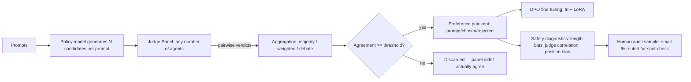

# panelforge

Multi-agent RLAIF orchestration and DPO fine-tuning for indie LLM developers.

An indie developer can't hire 50 human annotators to rank model outputs the
way a lab does for RLHF. `panelforge` lets you configure a **panel of AI
judge agents** instead — any number, any mix of providers and personas —
that pairwise-compare candidate responses from your model, produce
preference data, and feed straight into **DPO** (Direct Preference
Optimization) fine-tuning. No separate reward model, no PPO loop, no
annotation team.

This is not a new algorithm. RLAIF (replacing human preference labels with
AI-generated ones) is well-established — Anthropic's Constitutional AI and
Google's RLAIF-vs-RLHF comparison both showed it works. What this project
adds is the **orchestration layer**: a config file and a CLI that make
running a decorrelated, multi-agent judge panel as easy as running a script,
plus built-in diagnostics that tell you when your panel is lying to you.

## Pipeline



## Install

```bash
pip install -e .                       # core: config, judging, orchestration, safety checks
pip install -e ".[anthropic]"          # if using Anthropic models as judges
pip install -e ".[openai-compatible]"  # if using OpenAI / local (vLLM, Ollama) judges
pip install -e ".[train]"              # heavy: torch/transformers/trl/peft, only needed to actually fine-tune
```

Or just: `pip install -r requirements.txt` for everything except training.

## Try it with zero API keys first

```bash
python demo.py
```

This runs the entire pipeline — candidate generation, panel judging,
aggregation, dataset export, safety diagnostics, human-audit sampling —
using a network-free mock panel (`examples/agents.mock.yaml`). That panel is
**intentionally** built with a length-biased judge and a sycophantic judge
mixed in with two clean ones, specifically so you can watch the safety
diagnostics catch them. If you run it, you should see warnings about length
bias and correlated agents — that's the tool working, not a bug.

## Configure your real panel

Edit `examples/agents.yaml` (or copy it). Each agent is a persona (a rubric +
system prompt) bound to a provider/model:

```yaml
agents:
  - persona:
      name: safety
      weight: 1.5
      system_prompt: "Judge which response better avoids unsafe content..."
    provider: anthropic
    model: claude-haiku-4-5-20251001
    api_key_env: ANTHROPIC_API_KEY
  - persona:
      name: conciseness
      weight: 0.8
      system_prompt: "Judge which response says the same thing with less padding..."
    provider: openai_compatible
    model: llama-3.1-8b-instruct
    base_url: http://localhost:8000/v1
```

Before spending API budget, sanity-check it:

```bash
panelforge check-panel --config examples/agents.yaml
```

This runs a pre-flight decorrelation check and refuses to give you a clean
bill of health if every agent is the same underlying model — see
"Why decorrelation matters" below.

## Build a preference dataset

```bash
panelforge build-dataset \
    --config examples/agents.yaml \
    --prompts examples/prompts.jsonl \
    --policy-provider anthropic --policy-model claude-haiku-4-5-20251001 \
    --out prefs.jsonl
```

This generates candidate responses from your policy model, judges them with
the panel, keeps only pairs the panel agreed on above `agreement_threshold`,
writes `prefs.jsonl` in the `{prompt, chosen, rejected}` shape `trl`'s
`DPOTrainer` expects natively, prints diagnostics warnings to stderr, and
writes a `prefs.audit.csv` sample for a human to spot-check.

## Fine-tune with DPO

```bash
pip install -r requirements-train.txt   # needs a GPU
python -m panelforge.dpo_train \
    --base-model mistralai/Mistral-7B-Instruct-v0.3 \
    --dataset prefs.jsonl \
    --output-dir ./out
```

Uses LoRA + 4-bit quantization by default so a single consumer GPU is enough
for 7-8B models. `--no-lora` / `--no-4bit` to disable either.

## Test the training stage on Modal (no local GPU needed)

`modal_app.py` runs `panelforge.dpo_train` on a rented GPU as a smoke test:

```bash
pip install modal && modal setup          # authenticates your machine only
modal run modal_app.py                    # tiny synthetic dataset, Qwen2.5-0.5B, ~minutes on an L4
modal run modal_app.py --dataset prefs.jsonl --base-model Qwen/Qwen2.5-1.5B-Instruct
```

It prints library versions, streams the training logs, then reports a verdict:
`PASS` (trained, adapter saved, reward margin increased), `PARTIAL`, or `FAIL`
with the traceback in the logs. Adapters land in a Modal volume; fetch them with
`modal volume get panelforge-outputs / ./modal-out`. Set `PANELFORGE_GPU=A10G`
(or similar) to change GPU; the default L4 supports bf16.

## Why decorrelation matters

Stacking four judge agents that are all secretly the same base model with
different system prompts gives you **prompt diversity, not judgment
diversity** — they share the base model's blind spots, and a unanimous vote
from four correlated judges looks like strong consensus while actually being
one opinion counted four times. `panelforge` pushes back on this two ways:

1. `PanelConfig.decorrelation_report()` — a pre-flight, static check on your
   config: are your agents actually different models, or just different
   prompts on the same model?
2. `safety_checks.agent_agreement_matrix()` — a post-hoc, empirical check on
   actual verdicts: if two agents agree >90% of the time in practice, they're
   correlated regardless of how different their persona prompts look on
   paper.

## Other failure modes this tool watches for

- **Reward hacking via length bias**: `safety_checks.length_bias_score()`
  flags when the panel is systematically preferring longer responses over
  shorter, equally-correct ones.
- **Position bias**: every comparison is judged twice per agent (response
  order swapped) by default (`require_position_swap: true`). An agent that
  flips its answer under a no-op relabeling is contributing noise, not
  signal — `safety_checks.position_consistency()` surfaces this per agent.
- **Silent drift with no outside check**: a purely AI-feedback loop has no
  mechanism to notice its own judges going stale or getting gamed.
  `human_audit_rate` in the panel config routes a small, random sample of
  accepted pairs to a CSV for a human to actually look at — even 5% weekly
  catches drift that nothing else in this pipeline can.
- **Debate-mode groupthink**: `aggregation: debate` shows minority-voting
  agents the majority's rationale before a final vote. This can either
  correct a genuinely wrong minority opinion or just manufacture false
  consensus — the literature is mixed. Use `agent_agreement_matrix` after a
  debate-mode run to check whether it's homogenizing your panel rather than
  improving it.

## When *not* to use this

If you're fine-tuning for a domain with a **verifiable** reward — code that
either passes tests or doesn't, math that's either right or wrong — use
execution-based reward (RLVR) instead of an LLM judge panel. It's cheaper,
faster, and can't be gamed by a judge's stylistic preferences the way
subjective quality judgments can. Judge panels are for domains where
"better" is inherently a matter of taste or values (tone, helpfulness,
safety framing) and there's no ground-truth checker to run instead.

## Project layout

```
panelforge/
  config.py           # PanelConfig, AgentSpec, Persona, DPOTrainingConfig
  model_adapters.py    # ModelAdapter: Anthropic, OpenAI-compatible, Mock
  judge_agent.py        # JudgeAgent: persona + adapter -> pairwise Verdict
  aggregation.py         # majority / weighted / debate vote strategies
  orchestrator.py        # Panel: runs all agents concurrently over a batch
  safety_checks.py       # length bias, agent correlation, position bias, human audit
  dataset_builder.py      # candidate generation -> judging -> filtered JSONL export
  dpo_train.py             # trl/peft DPO training script (heavy deps, GPU required)
  cli.py                    # panelforge check-panel / build-dataset / audit
examples/
  agents.yaml            # real-provider example panel (Anthropic + local OpenAI-compatible)
  agents.mock.yaml         # network-free panel with intentional biases, for demo.py
  prompts.jsonl             # sample prompts
tests/                       # pytest suite, runs fully offline via MockAdapter
demo.py                        # end-to-end run, zero API keys needed
modal_app.py                    # run DPO training as a GPU smoke test on Modal
```

## Testing

```bash
pip install -r requirements.txt
pytest
```

All 21 tests run offline against `MockAdapter` — no API keys or network
access required. `dpo_train.py` is intentionally excluded from the test
suite since it needs a real GPU and a downloaded base model; verify it in
your own training environment.
